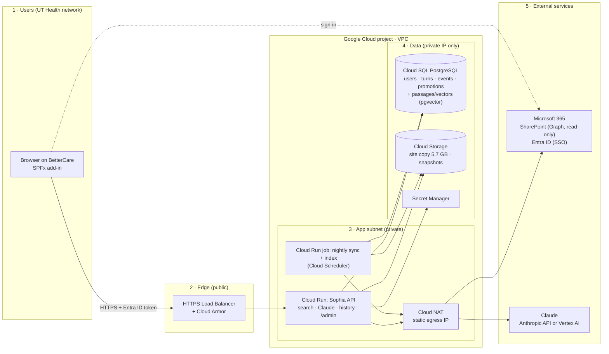

# Sophia — technical architecture

The source of truth for the technical diagram. Two parts: **what runs today**
(measured, 2026-09-30) and **the proposed Google Cloud deployment** (a design to
review with UT Health IT; nothing is provisioned yet).

## 1. Data stores

### Today (one laptop, everything on local disk)

| # | Store | Technology | Contains | Size | Personal data? |
|---|---|---|---|---|---|
| 1 | Site export | Files on disk (`data/site/`) | Read-only copy of BetterCare: 239 pages, 53 lists, ~3,600 library files, rendered page snapshots | 5.7 GB (files 5.2 GB, snapshots 568 MB) | Site content only |
| 2 | Search corpus | JSON (`data/index/chunks.json`) | 6,629 passages with title, heading, URL, dates | 9 MB | No |
| 3 | Embeddings | JSON (`data/embeddings.json`) | One 384-number vector per passage (`bge-small-en-v1.5`) | 21 MB | No |
| 4 | App database | SQLite (`data/sophia.db`) | `users` (name, role, department), `turns` (every question, answer, sources, topics, feedback), `events` (clicks), `promotions` (content Clinical IT pushes) | 3 MB | **Yes**: names + questions |
| 5 | Chat log | JSON lines (`data/logs/chat.jsonl`) | Per-turn diagnostics: question, rewrite, retrieved ids, scores, model, tokens, latency | < 1 MB | Yes: questions |
| — | In memory | Node process | Keyword (BM25) index and vectors, rebuilt at startup from 2 and 3 | ~100 MB RAM | No |
| — | Browser | sessionStorage / localStorage | The open conversation; the demo user id | KB | Yes (on the user's machine) |

External services called today: **SharePoint Online** (source, read-only, only during
export) and the **Anthropic API** (receives the question, the top 8–16 passages, and a
short profile: role + recent topics + last few questions).

### Proposed on Google Cloud

| # | Store | GCP service | Replaces | Network |
|---|---|---|---|---|
| A | Site copy + snapshots | **Cloud Storage** bucket, private, CMEK | Store 1 | Private access only (no public URLs) |
| B | App database | **Cloud SQL for PostgreSQL**, private IP, automated backups, point-in-time recovery | Stores 4 and 5 | Data subnet, private IP only |
| C | Passages + vectors | Same Cloud SQL instance with **pgvector** (or stay as files in bucket A, loaded at startup) | Stores 2 and 3 | Data subnet |
| D | Secrets | **Secret Manager** | `.env` | Google API, IAM-restricted |
| E | Logs / metrics | **Cloud Logging + Monitoring** (questions redacted from logs) | Store 5 diagnostics | Google API |

So production has **two databases**: one PostgreSQL instance (users, history,
feedback, promotions, and optionally the search index) and one storage bucket (the
site copy). Everything else is derived and can be rebuilt from them.

## 2. Components

| Component | Today | Proposed on GCP |
|---|---|---|
| Sophia API (search + Claude + history) | `node server/index.mjs` on a laptop | **Cloud Run** service, min 1 instance, in the app subnet (Direct VPC egress) |
| Site sync | Manual export from a signed-in browser | **Cloud Run job** on **Cloud Scheduler** (nightly), Microsoft Graph with `Sites.Selected` (read-only) |
| Index build | `npm run ingest` by hand | Same job, after sync; writes to A and C |
| Insights dashboard | `/admin` on the same server | Same service; admins only (Entra ID group) |
| Front end in SharePoint | Site copy + Chrome extension | **SPFx add-in** in the real BetterCare site; extension kept for testing |
| Claude | Anthropic API | Anthropic API via Cloud NAT fixed IP, **or Claude on Vertex AI** so data stays inside Google Cloud |
| Sign-in | Demo "signed in as" menu | **Entra ID (SSO)** token from SPFx; the API validates it on every request |

## 3. Network segments (proposed)

| Segment | What's in it | Allowed in | Allowed out |
|---|---|---|---|
| 1. Users | UT Health browsers on SharePoint | — | HTTPS to the load balancer only |
| 2. Edge (public) | External HTTPS **Load Balancer** + **Cloud Armor** (WAF, UT Health IP ranges only) | 443 from UT Health networks | App segment |
| 3. App (private subnet) | Cloud Run service and sync job | Load balancer only (ingress: internal + LB) | Data segment; Cloud NAT for Graph and Claude |
| 4. Data (private, no public IP) | Cloud SQL (private service access), Cloud Storage (Private Google Access) | App segment only | Nothing |
| 5. External SaaS | Microsoft 365 (SharePoint, Entra ID), Anthropic or Vertex AI | Via Cloud NAT static IP | — |

## 4. Open questions for UT Health IT
- Which GCP project / org folder, and does UT Health require a Shared VPC?
- Is Claude on Vertex AI approved (keeps prompts inside Google Cloud), or the Anthropic API?
- Retention period for stored questions, and who may see individual (named) history.
- Entra ID app registration for SSO and `Sites.Selected` on the BetterCare site.
- Should item-level SharePoint permissions be enforced in search (needed before opening to everyone).
